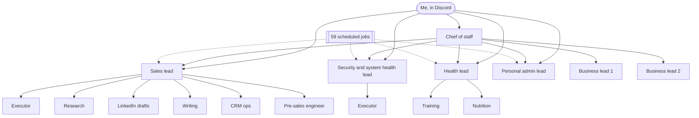

# openclaw-fleet

How I run 18 AI agents on one Mac Mini, and what broke along the way.

The agents run on [OpenClaw](https://github.com/openclaw/openclaw), the open-source agent gateway. OpenClaw handles the plumbing: chat channels, sessions, scheduled jobs and tool permissions. This repo covers what I built on top of it: how the agents are organized, how work moves between them, the rules that keep them cheap and honest, and the incidents that produced those rules.

It's a write-up with small example scripts. My live config stays private because it holds account names, credentials and personal data. [docs/patterns.md](docs/patterns.md#secrets) explains how I learned that the hard way.

## The fleet

I talk to the agents in Discord, mostly from my phone. Each domain lead has its own channel, and a chief-of-staff agent handles anything that crosses domains.

| Agent | Sub-agents | What it does |
|---|---|---|
| Chief of staff | none (routes to the leads) | Cross-domain requests, the cross-pod digest, arbitration when 2 leads disagree |
| Sales lead | executor, research, LinkedIn, writing, CRM ops, pre-sales | Meeting prep before every customer call, pipeline review, partner research, post drafts |
| Security and system health lead | executor | Nightly security audit, cron health, machine hygiene |
| Health lead | training, nutrition | Workout and nutrition plans from wearable data |
| Personal admin lead | none | Bills, travel, reminders, home upkeep, a single 8:00 brief |
| 2 business leads | none | Side businesses |
| Override + host executor | none | My direct line in, and the 1 agent trusted to run commands on the host |

That's 7 leads, 9 sub-agents and 2 utility agents. Sub-agents share their lead's workspace. Leads can't spawn each other, so work that crosses domains goes through the chief of staff.

Over the last 7 months the fleet has grown to 93 skills and 59 scheduled jobs. Where they can, jobs run a script first and only call a model for the part that needs judgment.

## Read next

- [docs/what-broke.md](docs/what-broke.md): 6 incidents, what caused each, and the rule it left behind. Start here.
- [docs/patterns.md](docs/patterns.md): the rules every agent and script follows now.
- [examples/](examples/): stripped-down versions of the token breaker, the evidence-checked pipeline runner and a script-first skill.

## Related

[taste-preferences](https://github.com/RealDavidArt/taste-preferences): the table of writing rules the agents check before drafting anything a customer will read.

MIT licensed. Built by [David Wooten Jr](https://github.com/RealDavidArt).
